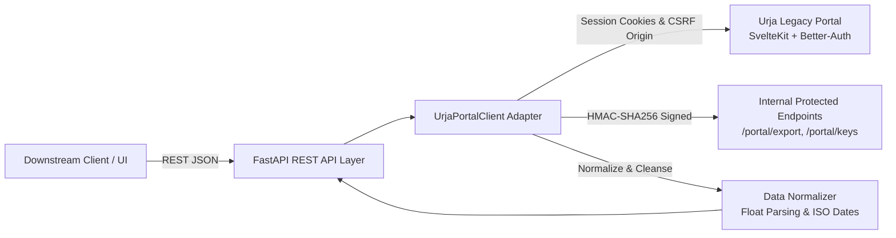

# Flock Energy — Urja Meter Ops REST API Wrapper

A high-performance, clean, and well-documented REST API proxy service that wraps the legacy **Urja Meter Ops** portal (`https://urja-ops.flockenergy.tech`).

This service automates authentication, session lifecycle management, CSRF validation, dynamic HMAC-SHA256 request signing, and data normalization—converting messy, heterogeneous legacy responses into strictly typed, production-ready JSON.

---

## Architecture Overview



---

## Key Features

- **Automated Session Management**: Automatically handles login, cookie persistence, and transparent re-authentication upon session expiration (1-hour TTL).
- **SvelteKit CSRF Bypass**: Automatically injects requisite `Origin` and `Referer` headers to comply with SvelteKit's cross-site request forgery security policies.
- **Cryptographic Request Signing**: Automatically retrieves signing keys and computes HMAC-SHA256 digests (`x-timestamp`, `x-signature`) to unlock restricted data endpoints (`/portal/export`).
- **Heterogeneous Schema Normalization**: Normalizes both legacy array structures and modern `v2` embedded stringified JSON (`classData`) into uniform Pydantic schemas.
- **Data Cleansing**: Transforms string-formatted readings (`"48438.74"`) to IEEE floating-point numbers, handles missing readings, and converts legacy timestamps (`DD/MM/YYYY HH:MM`) to ISO-8601 (`YYYY-MM-DDTHH:MM:SS`).
- **Complete Grid Hierarchy Extraction**: Reconstructs the full 7-tier distribution network: **Zone → Circle → Division → Subdivision → Substation → Feeder → Distribution Transformer → Meters**.
- **Interactive Documentation**: Out-of-the-box Swagger UI at `/docs` and ReDoc at `/redoc`, with an exported OpenAPI 3.0 specification in `openapi.json`.

---

## Project Structure

```
flock-energy-api/
│
├── app/
│   ├── __init__.py      # Package indicator
│   ├── config.py        # Settings and environment configuration
│   ├── models.py        # Pydantic V2 response schemas & validation models
│   ├── client.py        # UrjaPortalClient legacy adapter and scraper layer
│   └── main.py          # FastAPI application routes & lifespan handler
│
├── tests/
│   └── test_api.py      # Automated integration test suite
│
├── openapi.json         # Exported OpenAPI 3.0 specification
├── PROTOCOL.md          # Reverse-engineering protocol report & findings
├── REFLECTION.md        # Engineering reflections & architectural answers
├── README.md            # Setup instructions, architecture, & sample curls
├── requirements.txt     # Python runtime dependencies
└── .gitignore           # Git ignore patterns
```

---

## Getting Started

### Prerequisites
- Python 3.10+ (tested on Python 3.12)
- Git

### Installation

1. Clone or navigate to the repository:
   ```bash
   cd flock-energy-api
   ```

2. (Optional) Create and activate a virtual environment:
   ```bash
   python -m venv .venv
   # Windows:
   .venv\Scripts\activate
   # Linux/macOS:
   source .venv/bin/activate
   ```

3. Install project dependencies:
   ```bash
   pip install -r requirements.txt
   ```

### Configuration

Create an optional `.env` file in the root directory (defaults are already configured for the portal):
```env
URJA_BASE_URL=https://urja-ops.flockenergy.tech
URJA_OPERATOR_EMAIL=operator@urja.local
URJA_OPERATOR_PASSWORD=urja-ops-2026
APP_HOST=0.0.0.0
APP_PORT=8000
REQUEST_TIMEOUT=15.0
```

### Running the API Server

Start the API service using Uvicorn:
```bash
uvicorn app.main:app --host 0.0.0.0 --port 8000 --reload
```

Once started:
- **Interactive API Documentation (Swagger UI)**: [http://localhost:8000/docs](http://localhost:8000/docs)
- **Alternative Documentation (ReDoc)**: [http://localhost:8000/redoc](http://localhost:8000/redoc)
- **OpenAPI 3.0 Specification**: [http://localhost:8000/openapi.json](http://localhost:8000/openapi.json)

---

## API Endpoints & Sample Curls

### 1. Health Check
```bash
curl -X GET "http://localhost:8000/api/v1/health"
```
**Sample Response**:
```json
{
  "status": "healthy",
  "legacy_portal_connected": true,
  "legacy_url": "https://urja-ops.flockenergy.tech",
  "timestamp": "2026-10-10T14:38:50.000000Z"
}
```

---

### 2. Authentication Status
```bash
curl -X GET "http://localhost:8000/api/v1/auth/status"
```
**Sample Response**:
```json
{
  "authenticated": true,
  "user_email": "operator@urja.local",
  "user_name": "Ops Desk",
  "session_expires_at": "2026-10-10T15:23:26.325Z"
}
```

---

### 3. Manual Operator Login
*(Note: Authentication happens automatically on startup and self-renews, but you can also log in explicitly)*
```bash
curl -X POST "http://localhost:8000/api/v1/auth/login" \
     -H "Content-Type: application/json" \
     -d '{"email": "operator@urja.local", "password": "urja-ops-2026"}'
```
**Sample Response**:
```json
{
  "success": true,
  "message": "Successfully authenticated with Urja portal.",
  "session_token": "inmtTv25vMACRb3f...",
  "expires_at": "1 hour from issue (auto-refreshed)"
}
```

---

### 4. List Smart Meters (with Pagination & Search)
```bash
# Retrieve first page
curl -X GET "http://localhost:8000/api/v1/meters?page=1"

# Search by meter number or serial
curl -X GET "http://localhost:8000/api/v1/meters?q=J100000"
```
**Sample Response**:
```json
{
  "total": 403,
  "page": 1,
  "page_size": 20,
  "total_pages": 21,
  "data": [
    {
      "meter_id": "J100000",
      "serial_number": "SE33962",
      "make": "HPL",
      "phase_type": "single",
      "install_status": "Decommissioned",
      "dt_code": "DT-001"
    },
    {
      "meter_id": "J100001",
      "serial_number": "GE84132",
      "make": "L&T",
      "phase_type": "single",
      "install_status": "Installed",
      "dt_code": "DT-002"
    }
  ]
}
```

---

### 5. Get Specific Meter Details
```bash
curl -X GET "http://localhost:8000/api/v1/meters/J100000"
```
**Sample Response**:
```json
{
  "meter_id": "J100000",
  "serial_number": "SE33962",
  "make": "HPL",
  "phase_type": "single",
  "install_status": "Decommissioned",
  "install_type": "Whole Current",
  "dt_code": "DT-001",
  "build": "legacy",
  "geo": {
    "latitude": 26.938961002479868,
    "longitude": 75.83095696146852
  },
  "hierarchy": {
    "zone": "Jaipur Zone 1 (Z-01)",
    "circle": "Circle 1 (C-01)",
    "division": "Division 1 (D-01)",
    "subdivision": "Subdivision 1 (SD-01)",
    "substation": "Substation 1 (SS-01)",
    "feeder": "Feeder 1 (F-001)",
    "dt": "Malviya Nagar DT 1 (DT-001)",
    "breadcrumbs": null
  },
  "raw_nameplate": {
    "Meter ID": "J100000",
    "Serial No": "SE33962",
    "Make": "HPL",
    "Phase Type": "single",
    "Installation Status": "Decommissioned",
    "Installation Type": "Whole Current"
  }
}
```

---

### 6. Get Meter Consumption History & Metrics
```bash
curl -X GET "http://localhost:8000/api/v1/meters/J100000/consumption"
```
**Sample Response**:
```json
{
  "meter_id": "J100000",
  "total": 337,
  "summary": {
    "total_readings": 337,
    "latest_reading": {
      "timestamp": "2026-06-30T23:30:00",
      "raw_timestamp": "30/06/2026 23:30",
      "kwh": 48580.79,
      "kvah": 52467.25,
      "voltage_r": 220.0
    },
    "latest_kwh": 48580.79,
    "min_voltage_r": 218.0,
    "max_voltage_r": 242.0,
    "start_timestamp": "2026-06-23T23:30:00",
    "end_timestamp": "2026-06-30T23:30:00"
  },
  "readings": [
    {
      "timestamp": "2026-06-23T23:30:00",
      "raw_timestamp": "23/06/2026 23:30",
      "kwh": 48438.74,
      "kvah": 52313.84,
      "voltage_r": 226.0
    },
    {
      "timestamp": "2026-06-24T00:00:00",
      "raw_timestamp": "24/06/2026 00:00",
      "kwh": 48439.16,
      "kvah": 52314.29,
      "voltage_r": 229.0
    }
  ]
}
```

---

### 7. List Distribution Transformers (DTs)
```bash
curl -X GET "http://localhost:8000/api/v1/transformers?page=1"
```
**Sample Response**:
```json
{
  "total": 40,
  "page": 1,
  "page_size": 20,
  "total_pages": 2,
  "data": [
    {
      "code": "DT-001",
      "name": "Malviya Nagar DT 1",
      "feeder_code": "F-001",
      "capacity_kva": 100.0
    },
    {
      "code": "DT-002",
      "name": "Mansarovar DT 2",
      "feeder_code": "F-002",
      "capacity_kva": 63.0
    }
  ]
}
```

---

### 8. Get Full Organized Grid Hierarchy Tree
```bash
curl -X GET "http://localhost:8000/api/v1/hierarchy"
```
**Sample Response**:
```json
{
  "total_meters": 403,
  "zones_count": 2,
  "tree": {
    "Jaipur Zone 1": {
      "Circle 1": {
        "Division 1": {
          "Subdivision 1": {
            "Substation 1": {
              "Feeder 1": {
                "Malviya Nagar DT 1": [
                  {
                    "meter_id": "J100000",
                    "serial_number": "SE33962",
                    "status": "Decommissioned",
                    "phase_type": "single",
                    "make": "HPL"
                  }
                ]
              }
            }
          }
        }
      }
    }
  }
}
```

---

## Running the Automated Test Suite

Run integration tests using `pytest`:
```bash
python -m pytest tests/test_api.py -v
```
All 10 integration tests run against the live portal, validating:
- Service health & portal reachability
- Better-auth session verification
- Login workflow & credential verification
- Meter search & pagination
- Both legacy & modern v2 meter detail normalization
- Energy consumption metric extraction & floating-point conversion
- Distribution transformer listings
- Grid hierarchy generation via HMAC signing

---

## Architectural Trade-Offs & Intentional Omissions

1. **Direct JSON Endpoints over Full Browser Emulation (Playwright/Puppeteer)**:
   - *Trade-off*: Rather than running a headless browser that consumes 500MB+ of RAM per instance, we reverse-engineered the internal `/portal/*` REST endpoints and HMAC signature algorithm. This results in sub-100ms response times and minimal server resource usage.
2. **Transparent Auto-Reauthentication**:
   - *Trade-off*: Clients consuming `/api/v1/meters` do not need to manage cookie storage or handle token refreshes. If the legacy session expires, the adapter renews it inline and seamlessly returns the requested data.
3. **In-Memory Caching for Full Export**:
   - *Trade-off*: The `/api/v1/hierarchy` endpoint caches the full grid tree for 5 minutes. This reduces excessive cryptographic export calls to the legacy portal while ensuring sub-millisecond response latency.
4. **Intentional Omissions**:
   - Write/Mutation endpoints (e.g., updating meter status) are omitted because the legacy portal operates strictly as a read-only monitoring interface.
